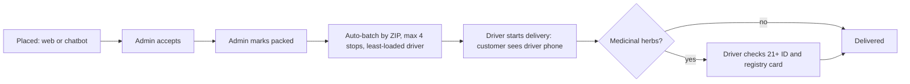

# Smokology user flows

Roles: **Customer** (no account, identified by phone), **Admin** (owner), **Employee** (driver). Staff sign in at `/staff` (prototype PINs, see `src/lib/store.ts`).

## Support ticket flow

```mermaid
flowchart TD
  A[Customer asks for help] --> B{Channel}
  B -->|Chatbot: "refund", "wrong item", "talk to a human"| C[Bot asks what happened]
  B -->|Order page: Report a problem| E
  C --> D[Bot asks phone number]
  D --> E[Ticket created: linked to latest order by phone]
  E --> F[Admin Tickets tab: status Open]
  F --> G[Admin assigns owner or driver, sets priority]
  G --> H[Admin replies: status In progress]
  H --> I[Customer sees reply in Orders tab and can answer]
  I --> H
  H --> J[Admin resolves: status Resolved]
```

Types: question, order_issue, refund (auto high priority). Drivers can be assigned tickets but replies are made by admin until driver ticket access is added.

## Order flow



Cancel is allowed until the order is out for delivery; stock is restored.

## Payments

- Card: Stripe Checkout. Webhook `/api/public/stripe-webhook` is signature-verified, idempotent, and checks the amount before marking paid.
- Bitcoin: BTCPay Server invoice. Webhook `/api/public/btcpay-webhook` (HMAC verified, idempotent) marks paid on `InvoiceSettled`.
- If a provider's env vars are unset, the order stays unpaid and an admin marks it paid by hand.
- Card and Bitcoin orders cannot go out for delivery until paid. Cash is collected by the driver.
- Store phone (`VITE_STORE_PHONE`) is the contact placeholder.

## Staff sign-in

Phone code login: the server texts a 6-digit code (Twilio when configured, otherwise printed in the server console), then sets an HttpOnly session cookie.
